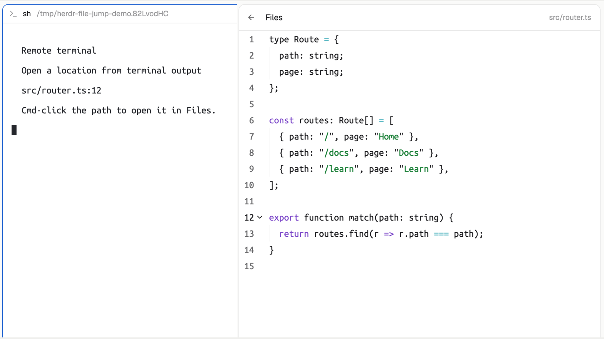

# Herdr File Jump

Cmd-click a path in a remote terminal to open it in Herdr's right-hand
Files panel. If the link includes a line number, Files scrolls to it
without taking focus from the terminal.



## Install

### Tell your agent

Paste this into a coding agent on the machine running Herdr Desktop:

> Read ~/.config/herdr-app/AGENTS.md, then add this mod: https://github.com/hpeng526/herdr-file-jump

The agent should follow [RECIPE.md](RECIPE.md) to wire the mod into a
personal layout without editing the shipped layout. This mod is for
Herdr Desktop (built on 0.1.18), not the Android or iOS client.

### Install by hand

Copy `mods/herdr-file-jump/` into Herdr's mods directory. In a personal
layout with the standard right-hand Files stack, set the `files` block's
`content.mod` to `herdr-file-jump` and add `herdr-file-jump` to the root
`link_handlers` list, keeping existing handlers.

For a fresh setup based on Herdr's stock `main` layout, the example
wires these two settings together. From this repository, with Herdr
running:

```sh
app_home=${HERDR_APP_HOME:-"$HOME/.config/herdr-app"}
test ! -e "$app_home/mods/herdr-file-jump" &&
test ! -e "$app_home/layouts/main-file-jump.json" &&
cp -R mods/herdr-file-jump "$app_home/mods/" &&
herdr-app check "$app_home/mods/herdr-file-jump" &&
cp examples/main-file-jump.json "$app_home/layouts/" &&
herdr-app do layout.switch --name main-file-jump
```

## Use

In a remote POSIX terminal, print an existing text path, for example
`printf '%s\n' /etc/hosts`. On macOS, hold Cmd and click the printed
path. On Linux and Windows, use Ctrl-click. The Files panel opens the
file on the terminal's machine. The back arrow returns to the file
tree. When using the example layout, switch back with
`herdr-app do layout.switch --name main`.

The mod handles recognized absolute and relative POSIX paths, including
`src/main.rs:42`, and recognized `file://` links. Relative paths are
resolved from the clicked terminal's working directory. Local links
retain Herdr's default behavior. It cannot make bare filenames that
Herdr does not recognize clickable, and it does not preview binary
files.

It reads files via the connected Herdr Core and retains the built-in
Files panel's `sh` or PowerShell directory listing and Git reads. A
`~/` link runs `printenv HOME` on the source machine. It does not edit
source files, run their contents, open an external editor, or contact
third-party services.

## Checks

```sh
node --experimental-vm-modules --test tests/*.test.cjs
herdr-app check mods/herdr-file-jump
```
