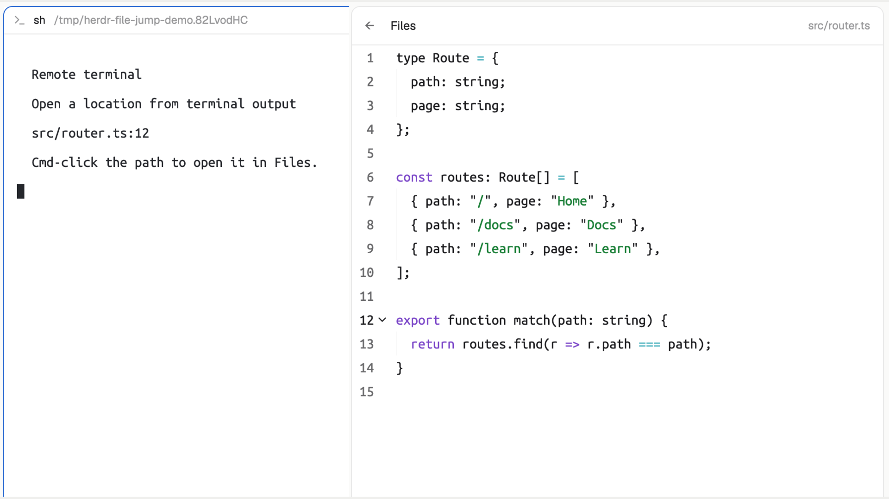

# Herdr File Jump

Cmd-click a path printed in a remote terminal and the right-hand Files
panel opens that file on the terminal's machine. A link with a line
number scrolls the preview to that line. The terminal stays focused.

## What you see

- The regular right-hand Files panel, rounded to 10 px with a 1 px
  theme border and the theme's background.
- A 42 px header with 14 px horizontal padding. The title is
  semibold, the path is dimmed and truncated on the right, and a back
  arrow appears while a file is open.
- Below the header is the usual scrollable file tree with 28 px rows
  and Git status letters. During a preview, it is replaced by a
  read-only code editor with line numbers and the terminal's font
  and font size. Loading and read errors appear beneath the header.

## How it behaves

- Cmd-click (Ctrl-click on Linux or Windows) handles a file link that
  Herdr already recognizes in a remote terminal. The panel opens even
  if hidden or showing Changes. The clicked terminal keeps focus.
- Absolute paths use the source machine. Relative paths use that
  terminal's working directory, even in a different split. `~/` means
  the source machine's home directory. Local links behave as before.
- For a `:line`, `:line:column`, or supported line range, the editor
  scrolls to the first corresponding line. A `file://` link can carry
  a `#L` anchor. The back arrow restores the original tree and its
  open folders. A newer preview takes precedence over an older read.

## Built from

- `mods/herdr-file-jump/` contains the manifest, `main.js`, `link.js`,
  `paths.js`, and four file-tree icons. The manifest uses
  `place: "none"` and a file link rule. No keys are added.
- `main.js` is based on the stock Files panel in Herdr App 0.1.18.
  It uses `gpui-kit` and `gpui-base` and opens the target in an
  `EditorState` configured as read-only.
- `link.js` resolves the click using the source machine and working
  directory. It calls `layout.select` and `layout.show`, then sends an
  expiring request scoped to the current layout and space through
  shared state. The Files view consumes that request and uses
  `readTextFile(path, { on })` to read on the originating machine.
- `paths.js` parses plain paths and file URIs and computes UTF-16
  selection offsets. Commands inherited from Files include `sh` or
  PowerShell for listing directories and `git` for status. The link
  handler invokes `printenv HOME` for tilde paths only.

## Watch out

- Copy the mod into `mods/`. In a **personal copy** of the person's
  layout, point the `files` block at `herdr-file-jump` and append the
  mod ID to the root `link_handlers`. Keep the `panel`, `panel-body`,
  and `files` IDs and any unrelated handlers. If the layout is
  shipped, clone it before editing it. This is a mod package, so it
  does not contain an installable `layouts/` directory. A main-based
  wiring example lives in `examples/`.
- The handler reads remote files outside the mod directory via Herdr
  Core. It does not write to those files or call external services.
  Bare filenames that Herdr does not detect, Windows-style source
  paths, and binary previews are not supported. The inherited preview
  displays at most 400,000 characters.

## Done when

- `herdr-app check mods/herdr-file-jump` and the repository tests pass.
- With Files closed, modified-clicking a remote `path:line` reveals
  Files, displays the right machine's file, and scrolls to the line.
- Opening a second link replaces the preview. Back returns to the
  prior tree. Local terminal links still use Herdr's original behavior.
